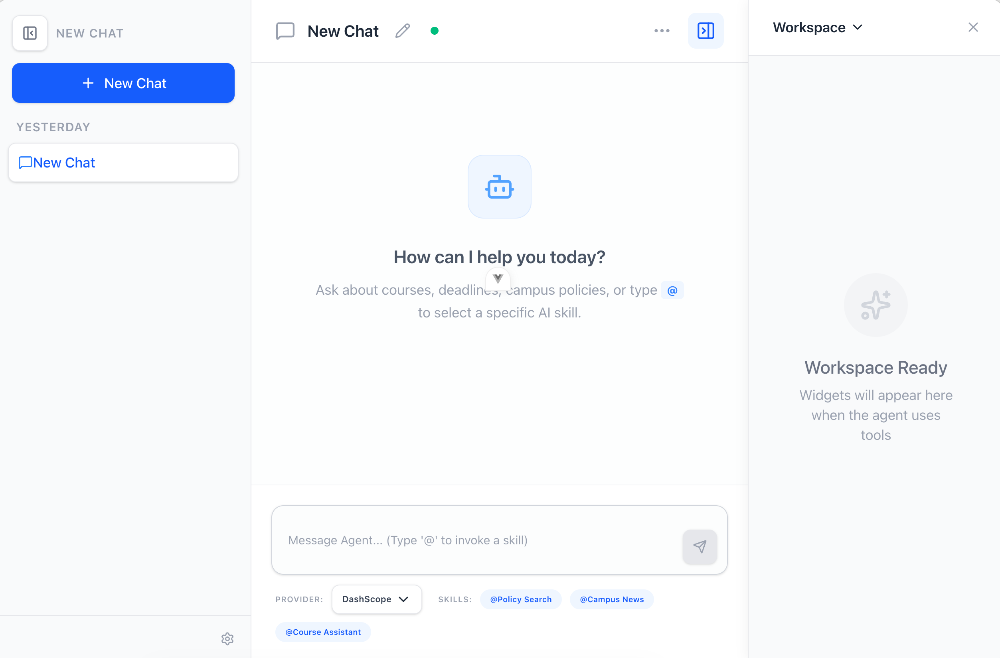

[](https://classroom.github.com/a/py413vYq)

# SUSTech Campus Assistant

An AI-powered campus assistant for SUSTech students, providing policy search, course support, deadline management, campus news, and more. Built on a ReAct/LangGraph agent architecture with a Vue 3 frontend.



## Features

| Feature | Description |
|---------|-------------|
| **Policy Search** | RAG-based retrieval over 20 official SUSTech PDF documents (2022--2025 training plans, regulations, etc.) with source citations |
| **Course Assistant** | Document analysis, quiz generation, and course material management |
| **Campus News** | Search and summarize campus news from multiple sources |
| **Deadline Management** | Track assignment deadlines with filtering and alerts |
| **Email Integration** | Read, compose, and reply to emails within the assistant |
| **Agent Memory** | Persistent conversation memory across sessions |
| **Multi-provider LLM** | Switch between OpenAI, DashScope, and other OpenAI-compatible providers |
| **Bilingual UI** | Chinese and English interface via Vue I18n |

## Architecture

```
packages/
├── core/       # ReAct engine (LangGraph + FastAPI), tools, skills, RAG pipeline
├── cli/        # Command-line interface and index builder
├── gui/        # Vue 3 + TypeScript + Pinia frontend
└── desktop/    # Electron desktop app wrapper
```

## Quick Start

### Prerequisites

- Python >= 3.12
- Node.js >= 20
- [uv](https://docs.astral.sh/uv/) (Python package manager)
- [pnpm](https://pnpm.io/) (Node.js package manager)
- [Task](https://taskfile.dev/) (task runner)

### Installation

```bash
git clone https://github.com/sustech-cs304/team-project-26spring-26s-5.git
cd team-project-26spring-26s-5

# Install all dependencies (Python + Node.js)
task init

# Configure environment
cp .env.example .env
# Edit .env with your LLM API key (OpenAI or DashScope)
```

### Running

```bash
# Terminal 1: start backend API server
task dev:server

# Terminal 2: start Vue frontend
task dev:gui
```

Open http://localhost:5173 in your browser. Type `@` in the chat input to select a skill (Policy Search, Campus News, Course Assistant).

### CLI Usage

```bash
# Interactive chat
cd packages/cli && uv run agent-cli chat

# Start API server with custom config
uv run agent-cli serve --env-file /path/to/.env --port 9000
```

## Usage Examples

Type `@` in the chat input to select a skill, then ask in natural language.

### Policy Search

Select **@Policy Search** to query official SUSTech policies and training plans:

- "转专业需要满足什么条件？"
- "2023 级计算机专业毕业需要多少学分？"
- "GPA 是怎么计算的？"

The assistant retrieves relevant excerpts from 20 official documents and answers with `[Source n]` citations linking to specific documents and pages.

### Course Assistant

Select **@Course Assistant** for course material analysis and study support:

- "帮我分析这份课程资料的主要知识点"
- "根据这份 PPT 生成 10 道选择题"
- "帮我推荐几门适合大三计算机专业、对 AI 感兴趣的课程"

Supports document analysis, quiz generation (multiple choice / true-false / fill-in / short answer), and personalized course recommendations with side-by-side comparison.

### Campus News

Select **@Campus News** to browse and search campus announcements:

- "今天有什么校园新闻？"
- "帮我搜索 career fair 相关的通知"
- "生成今天的校园新闻摘要"

Aggregates news from multiple sources (official site, email) with a news widget, keyword search, date filtering, and daily digest generation.

### Deadline Management

Use the Deadline panel in the workspace to manage academic deadlines:

- Create, edit, and delete deadlines with flexible date types (single day, time-specific, date range)
- Filter by status, date range, and completion
- Calendar view for visual overview
- Sync external deadlines via LLM conversation ("帮我添加一个 4 月 15 日截止的作业")

### Agent Memory

The assistant remembers information across sessions:

- "请记住我是计算机专业大三学生"
- "我已经修过 CS109 和 MA212"

Memories are stored as Markdown files organized by topic, readable and editable by both the agent and the user.

## Configuration

Key environment variables in `.env`:

| Variable | Description | Default |
|----------|-------------|---------|
| `OPENAI_API_KEY` | LLM API key (OpenAI or compatible) | required |
| `OPENAI_BASE_URL` | Custom API endpoint | OpenAI default |
| `MODEL_NAME` | LLM model name | `gpt-4o-mini` |
| `EMBEDDING_API_KEY` | Embedding API key (for index rebuild only) | - |
| `EMBEDDING_BASE_URL` | Embedding API endpoint | DashScope |
| `EMBEDDING_MODEL` | Embedding model | `text-embedding-v4` |

> The policy search index is pre-built and included in the repository. You only need `EMBEDDING_API_KEY` if you want to rebuild the index after adding new PDFs.

## Testing

```bash
# Run all checks (lint + format + tests)
bash scripts/check.sh

# CI mode (no auto-format)
bash scripts/check.sh --check-only

# Run tests only
task test
```

## Tech Stack

| Component | Technology |
|-----------|------------|
| Agent Engine | LangChain + LangGraph |
| Web API | FastAPI + Uvicorn |
| Frontend | Vue 3 + TypeScript + Pinia |
| Desktop | Electron |
| Vector Search | FAISS + DashScope Embeddings |
| Database | SQLModel + SQLite |
| Python Tooling | uv, Ruff, pytest |
| Node Tooling | pnpm, Vite, Vitest |
| CI/CD | GitHub Actions (lint, test, build, package) |
| Task Runner | Taskfile (go-task) |

## Known Limitations

- Policy search currently covers SUSTech documents only (20 PDFs, 2022--2025)
- CLI does not support skill selection (use the web UI or API)
- Email feature requires IMAP/SMTP credentials configured in settings

## Documentation

See [`docs/zh-CN/`](docs/zh-CN/index.md) for full documentation (Chinese), including:

- [User Guide](docs/zh-CN/user-guide/index.md) -- installation, configuration, feature guides
- [Design Docs](docs/zh-CN/design/index.md) -- architecture and implementation details
- [Developer Guide](docs/zh-CN/devs/index.md) -- code conventions, project structure, contribution guide
