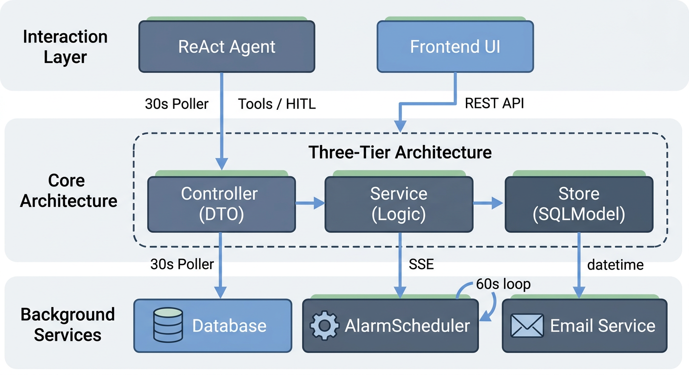
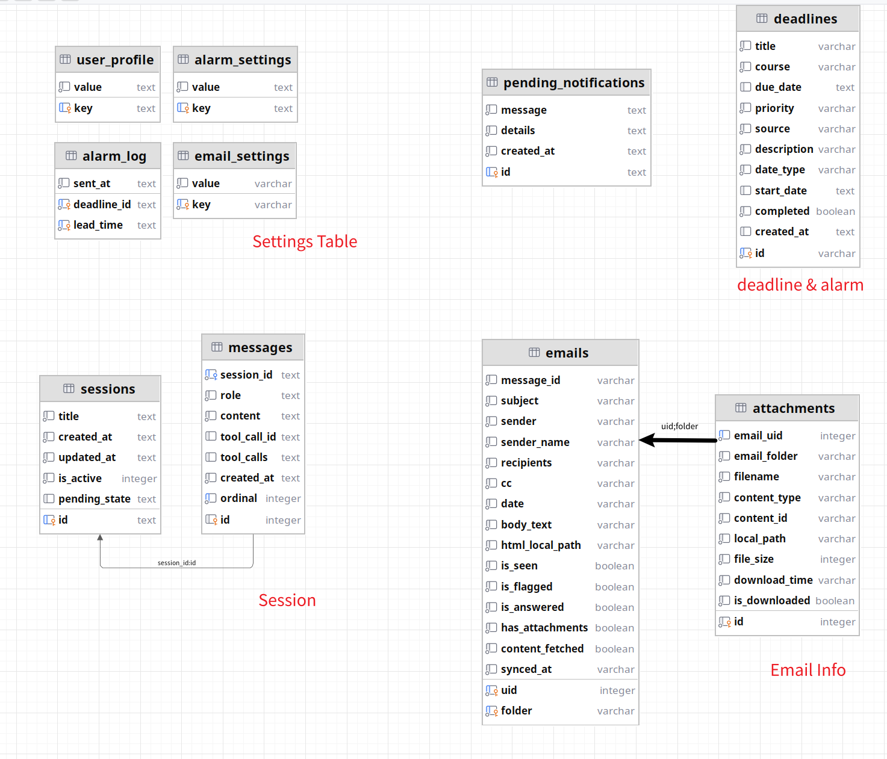
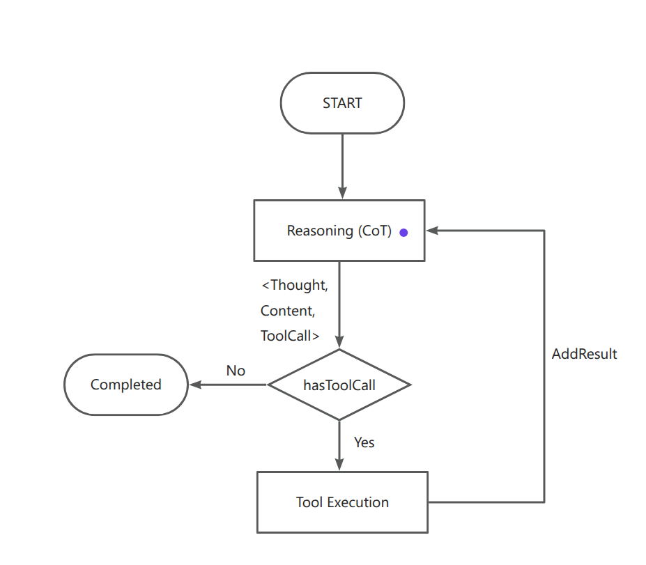
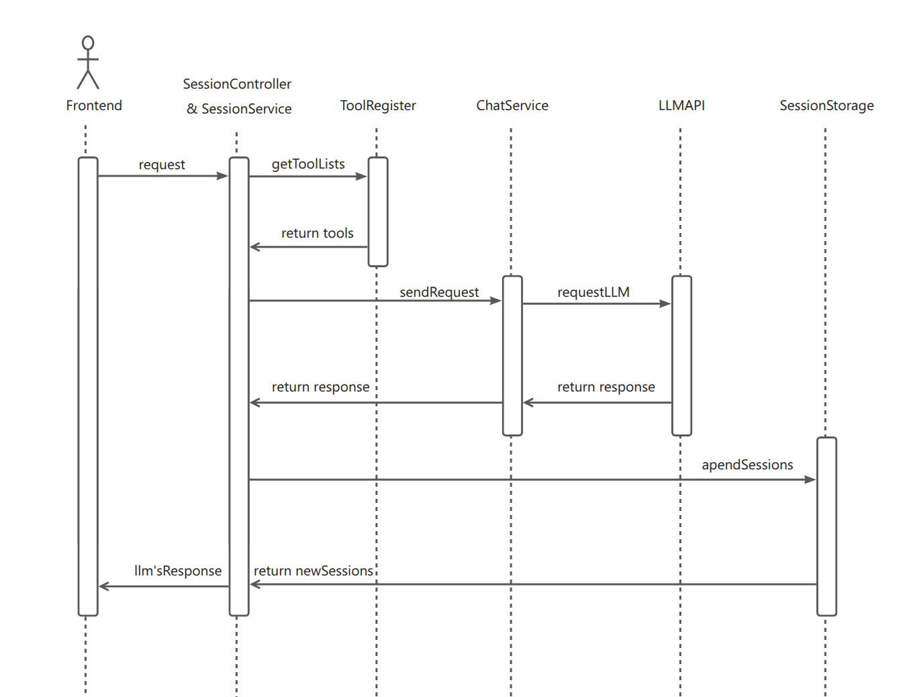
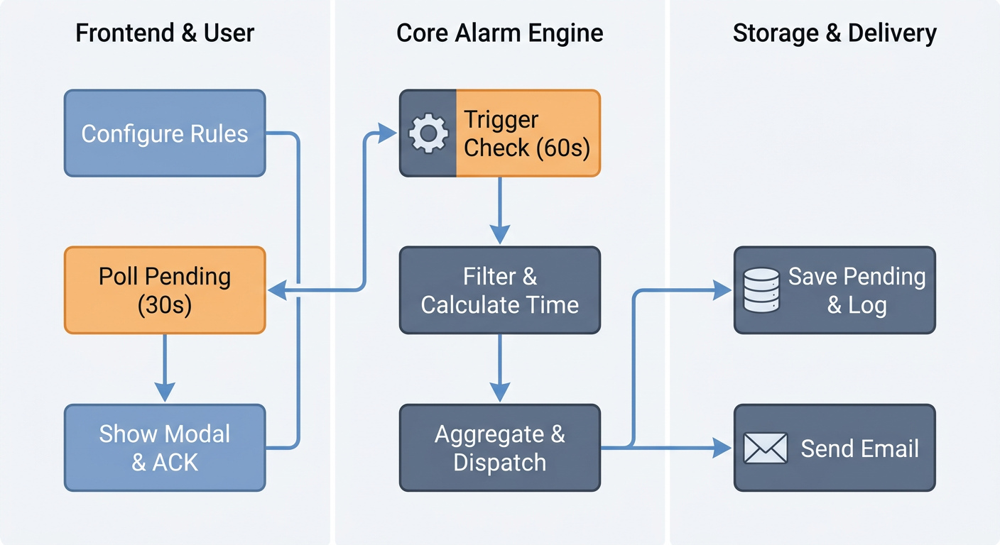
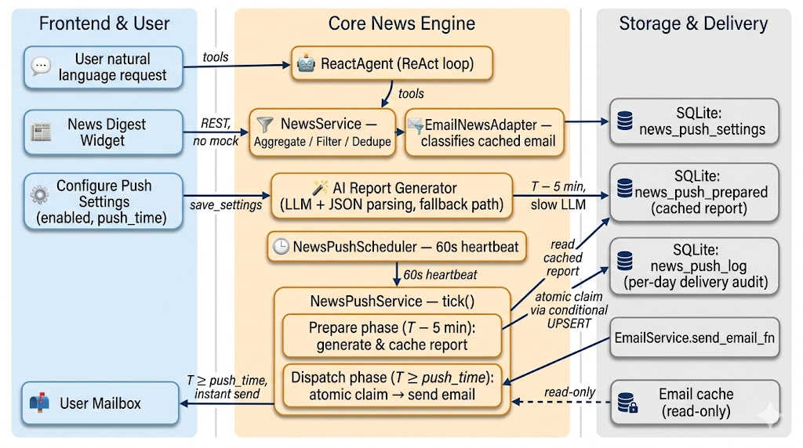
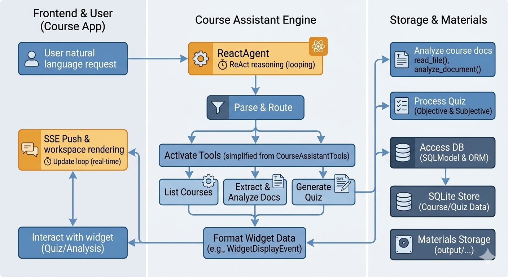
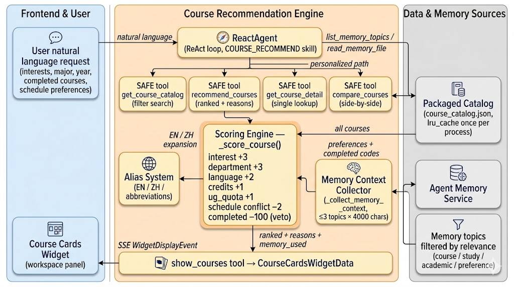
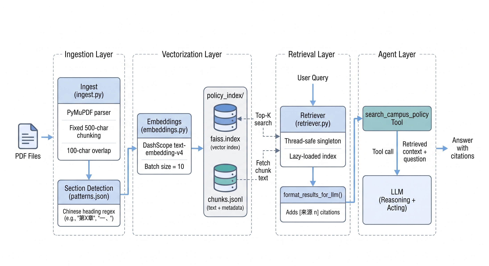

# Sprint-1 Progress Report
> Group Members: 祝超、周圣力、王韬杰、董万希、黄政东
> 
> Repo Link: https://github.com/sustech-cs304/team-project-26spring-26s-5

## Basic Designs of System 

### 1. Architecture Design



The complete project architecture is illustrated in the figure above. We strictly adhered to **modern software development workflows**, incorporating the **MVC model, design patterns, layered architecture, rigorous coding standards and GitHub-based CI/CD integration** to ensure **high-quality code evolution**. Detailed architectural designs are elaborated in the following sections.

### 2. UI Design Mockup


*(The image below serves as the UI design mockup for this primary interface, an interactive UI design mockup is available at [here](https://monica.im/share/artifact?id=vYZr8ydF3DaVpTwyWjkefi).)*

The primary interface consists of three main panels: **a left sidebar** for navigation and session management, **a central chat panel** for conversational interaction with the AI assistant, and **a right workspace panel** for contextual content display. We maintain a clean three-column layout with consistent visual hierarchy — color-coded message bubbles, progressive disclosure of advanced features, and a shared workspace panel that consolidates calendar, document preview, and web source views without requiring tab switching. Detailed descriptions of each panel and the underlying design rationale are provided in the sections below.


## Details of System Architecture

### Module Structure

The project adopts a **Monorepo** structure, with the core codebase divided into three independent packages:

```text
team-project-26spring-26s-5/
├── packages/
│   ├── core/          # Core backend business logic (Agent, Tools, API)
│   ├── cli/           # CLI integration entry point
│   └── gui/           # Vue3 frontend
├── docs/              # Chinese development documentation
├── .github/           # CI/CD configuration
├── scripts/           # Check scripts
├── Taskfile.yml       # Unified task orchestration
└── .env.example       # Environment variable template
```

- **`core`**: Contains the Agent reasoning engine, Tool registry system, and a three-layer Controller–Service–Store backend API. It serves as the business core of the entire application.
- **`cli`**: Integrates `core` via the command line, providing a lightweight interactive entry point. It is decoupled from `core` for ease of independent testing.
- **`gui`**: A Vue 3-based frontend application that communicates with the FastAPI interface exposed by `core` via HTTP/SSE.

Each of the three packages maintains its own `pyproject.toml` / `package.json`, with isolated dependencies that do not interfere with one another.

---

### Technology Stack

| Layer | Technology | Rationale |
|-------|-----------|-----------|
| Frontend Framework | Vue 3 + TypeScript | Composition API and type system improve maintainability |
| Frontend State | Pinia | Lightweight, type-friendly replacement for Vuex |
| Frontend Styling | Tailwind CSS | Atomic CSS, reduces style coupling |
| Frontend Package Manager | pnpm | Disk-efficient, strict dependency isolation |
| Backend Framework | FastAPI | Native async support, automatic OpenAPI documentation generation |
| Agent Framework | LangChain | Provides ReAct reasoning chain and Tool call abstraction |
| Data Validation | Pydantic v2 | Declarative type validation, automatic HTTP 422 responses |
| ORM | SQLModel | Unifies Pydantic model and database table definitions |
| Task Orchestration | Taskfile (go-task) | Unified frontend/backend build entry point, one-line initialization and startup |

The project uses Taskfile for complete lifecycle orchestration:

```bash
task init        # One-command installation of all dependencies (Python uv sync + pnpm install)
task dev:server  # Start FastAPI backend (:8000)
task dev:gui     # Start Vue development server (:5173)
task test        # Run all tests
```

---

### Backend Layered Architecture

The backend strictly follows a **Controller – Service – Store** three-layer architecture with clearly defined responsibilities at each layer:

- **Controller Layer** (FastAPI Router + DTO)
    - Pydantic automatically intercepts format errors → HTTP 422
    - Handles request parsing only, contains no business logic
- **Service Layer** (sole business logic layer)
    - Business validation (state machine, permissions, date range)
    - REST Controller and Agent Tool share the same Service, eliminating duplicated logic
- **Store Layer** (pure executor)
    - SQLModel async ORM, no hand-written SQL
    - Accepts strongly-typed objects only, performs no format validation

Backend code development strictly follows **PEP 8** and **Google Python Style Guide**, enforced by Ruff (formatting and linting) and mypy (strict type checking). Key design principles include:

1. **Shared Service Layer**: Unlike traditional backend services, Agent-based applications inherently have two business logic entry points: the REST Controller handles frontend interactions, while Tool functions handle LLM calls. This project consolidates business logic into the Service layer, allowing both entry points to share a single implementation and eliminating the risk of duplicated logic maintenance.
2. **Strongly-Typed Inter-Layer Communication**: All layers communicate via Pydantic/SQLModel strongly-typed objects. Passing raw `dict` is prohibited, and type checking is fully leveraged to fundamentally eliminate runtime errors caused by type inconsistencies.
3. **Design Patterns**: Modern design patterns are used extensively to improve code maintainability, including Dependency Injection, Singleton, Event-Consumer, and Interface patterns.
4. **REST API Design**: Entity resource operations follow RESTful conventions, centered on resource paths with `GET` / `POST` / `PATCH` / `DELETE` semantics to distinguish operation types. For complex business semantics, action-based endpoints are used as appropriate extensions to maintain URL design consistency.

---

### Frontend Layered Architecture

The frontend likewise follows a three-layer separation:

```
View Layer (Vue Components)
    ↓ calls
Service Layer (business logic encapsulation)
    ↓ calls
API Layer (HTTP request encapsulation)
```

Frontend code development strictly follows the **Vue 3 Official Style Guide** and **Airbnb TypeScript Guidelines**, enforced by Prettier and ESLint. Key design principles include:

1. **Three-Layer Separation (View – Service – API)**: The View layer is responsible solely for rendering and user interaction. Business logic is consolidated in the Service layer, and HTTP requests are encapsulated in the API layer. Each layer has clearly defined responsibilities, facilitating independent testing and reuse.
2. **Component Modularization**: All components are written using Vue 3 `<script setup lang="ts">` + Composition API. Logic is extracted into reusable Composables by feature, avoiding duplicated logic across components. State management is centralized via Pinia Store; shared state between components does not rely on prop drilling.
3. **Elimination of Hardcoded Strings**: All user-visible text is managed through Vue I18n. Hardcoded UI strings in source code are prohibited. Both Chinese and English language packs are maintained in parallel, preserving the capability for future internationalization.

---

### Testing Strategy

The project establishes a comprehensive testing system for both frontend and backend to ensure the reliability of critical paths:

**Backend Testing (`packages/core` / `packages/cli`)**

| Test Type | Coverage |
|-----------|----------|
| Unit Tests | Service layer business logic, Tool function boundary conditions |
| API Integration Tests | Controller layer interface contract validation |
| Mock Strategy | Mock key external resources such as LLM calls and web tool fetches to improve test repeatability |

**Frontend Testing (`packages/gui`)**

| Test Type | Tool | Coverage |
|-----------|------|----------|
| Component Tests | Vitest | Vue component rendering and interaction logic |
| Business Entity Tests | Vitest | Extracted Service / Store business logic |
| E2E Tests | Playwright | Critical user flows (e.g., sending messages, tool call display) |

The decoupled design of the Service and Tool layers is the foundation of testability — by mocking the LLM interface, deterministic unit tests can be performed on any tool.

---

### Engineering Practices

**Code Standards**

The backend (Python) uses Ruff for formatting and linting (covering PEP 8, Pyflakes, isort, bugbear, and other rule sets), with mypy configured in strict mode to enforce full type annotations. The frontend (TypeScript/Vue) uses Prettier, ESLint, and oxlint in combination. All source code is **strictly required to be in English**, with a custom Semgrep rule in CI to intercept any CJK character contamination.

**Continuous Integration**

A unified `scripts/check.sh` check script is provided locally. Its CI mode (`--check-only`) is fully consistent with GitHub Actions behavior, containing the following parallel jobs:

```
lint ──────────┐
               ├──→ test-python (pytest + coverage)
language-check ┤
               └──→ test-vue (vitest + type-check + build)
```

Any failing job blocks PR merging.

**Branching and Version Management**

The `main` branch has Branch Protection enabled, prohibiting direct pushes. All features are merged via Pull Request, requiring at least one member's review approval and a fully green CI pipeline. The merge strategy is uniformly **Squash and Merge**, ensuring a linear and clean commit history on the main branch. Version releases are tagged with Git Tags, accompanied by `CHANGELOG.md` recording the changes for each version.


### Database Design



The project uses **SQLite** as the persistence storage, operated via SQLModel async ORM. The database contains four groups of tables:

- **Settings Tables** (`user_profile`, `alarm_settings`, `email_settings`): Store user configuration information in a key-value structure, including personal preferences, alarm parameters, and email account settings, allowing flexible extension of configuration items.

- **Deadline & Alarm Tables** (`deadlines`, `alarm_log`, `pending_notifications`): The `deadlines` table records core fields such as task title, course, due date, priority, and completion status; `alarm_log` associates with specific tasks via `deadline_id`, recording the send time and lead time of each reminder; `pending_notifications` stores the queue of pending push notifications.

- **Session & Message Tables** (`sessions`, `messages`): The `sessions` table maintains meta-information for conversation sessions (title, active status, pending state, etc.); the `messages` table associates with `sessions` via the `session_id` foreign key, guarantees message ordering through the `ordinal` field, and records fields required for Agent conversations such as `role`, `content`, and `tool_calls`.

- **Email Tables** (`emails`, `attachments`): The `emails` table uses `<uid, folder>` as a composite business key, corresponding to the unique mail identifier in the IMAP protocol, storing email metadata and local cache status; the `attachments` table associates with `emails` via `email_uid` + `email_folder`, recording the filename, type, local path, and download status of each attachment.

- **News Push Tables** (`news_push_settings`, `news_push_log`, `news_push_prepared`): The `news_push_settings` table stores the user's daily campus news push configuration (enabled flag, push time, fetch limit) as a single key-value row; `news_push_log` records per-day email delivery status keyed by `target_date`, supporting the atomic claim and idempotent SUCCESS guarantee that drives once-per-day deduplication; `news_push_prepared` caches the LLM-generated daily report keyed by `target_date`, bridging the prepare-phase (T − 5 min) and dispatch-phase (T ≥ push_time) of the push pipeline so the scheduled send carries no LLM latency.


## Details of UI Design

The primary goal of this UI design is to create a **unified, distraction-free workspace** that enables students to review course content, manage deadlines, get course recommendations, and keep up with the latest campus news by interacting with an AI assistant in a single view. The design prioritizes **clarity, contextual awareness, and ease of use**.

### 1. Core Layout Structure

The UI uses a **three-column responsive layout**, optimized for both desktop and large tablet screens, with a collapsible right sidebar to maximize content space when needed:
| Column | Purpose | Key Design Decisions |
|--------|---------|----------------------|
| Left Sidebar | Session & Navigation | Provides persistent access to past chat sessions and tools, using neutral grays and minimal icons to avoid drawing focus away from the learning content. |
| Central Chat Panel | AI Interaction | The main communication channel, with clear visual separation between user and assistant messages (color-coded bubbles) to maintain readability during long conversations. |
| Right Workspace Panel | Tool Display | A dedicated viewport for tools, e.g., deadline calendar, PDF reader. Providing a clear reference for the user while not disturbing the view of AI interaction. |

---

### 2. Primary Interface: Contextual Chat with Learning Materials
#### UI Design Mockup Description

The design is structured as follows:
1.  **Left Sidebar (Persistent Navigation)**
    -   Top section: A prominent “+ New Chat” button (high-contrast blue) to initiate new study sessions.
    -   “Recent Sessions” list: Displays past study topics (e.g., “CS101 Final Prep”, “Spring Course Selection”) with simple icons to denote the type of task.
    -   Bottom section: A minimal “User Profile” and settings icon, kept subtle to avoid clutter.
2.  **Central Chat Panel (Main Interaction)**
    -   Message bubbles with distinct visual styles:
        -   User messages: Solid blue background with white text, right-aligned to signal the student’s input.
        -   Assistant responses: Light gray background with dark text, left-aligned, with clear section breaks for explanations and prompts; the thinking process is folded by default to avoid visual distraction, while the user can expand it to examine the detailed task-solving process.
    -   Contextual feedback badges: Small, subtle indicators (e.g., “Accessed: CS101_Lec8_Recursion.pdf”) to confirm the AI has loaded the student’s material, building trust.
    -   Input bar: A bottom-aligned text field with a send button, plus “Suggested Skills” tags (e.g., `@CourseAssistant`, `@Deadline`, `@CampusNews`, `@CourseRecommend`) to hint at the system’s context-aware features without overwhelming the user.
3.  **Right Workspace Panel (Contextual Content)**
    -   A shared component for tools, including: calendar display (task / week / month) views, document (e.g., lecture slides) preview, course recommendation cards, campus news digest, and web source preview.
    -   A drop-down menu to switch between different views, enhancing the clarity of tool usage.

#### Design Rationale
-   **Contextual Alignment**: The split-screen layout eliminates the need for students to switch between tabs, keeping the AI’s explanations and the source material in view simultaneously.
-   **Visual Hierarchy**: Color coding (blue for user actions, neutral grays for navigation, soft whites for content) ensures the student’s focus stays on the chat and learning materials, not the UI itself.
-   **Progressive Disclosure**: Features like “Suggested Skills” and contextual highlighting are introduced subtly, guiding students to use advanced capabilities without overwhelming them during initial use.

---

### 3. UI Design Mockup
*(The image below serves as the UI design mockup for this primary interface, illustrating the three-column layout and key visual elements described above.)*


An interactive UI design mockup is available at [here](https://monica.im/share/artifact?id=vYZr8ydF3DaVpTwyWjkefi).


---

### 4. Key UI Design Principles for This System
1.  **Consistency**: All interactive elements (buttons, message bubbles, tags) follow the same color scheme and styling rules to reduce cognitive load for students.
2.  **Accessibility**: High contrast ratios between text and backgrounds, clear text hierarchy, and scalable UI components ensure the interface is usable in different lighting conditions and screen sizes.
3.  **Clarity of Purpose**: Every UI element directly supports the core task of having an easier campus life with an AI assistant; decorative elements are minimized to avoid visual noise.
4.  **Feedback**: The UI provides clear confirmation of actions (e.g., the green checkmark for “Accessed” materials) to let students know the system is working as expected.

## Details of Key Business Design

### LLM Interaction Based on the ReAct Model



The Agent core of this project is implemented based on the **ReAct (Reasoning + Acting)** paradigm, orchestrating an alternating loop of reasoning and tool execution via LangGraph `StateGraph`. In each iteration, the LLM first reasons over the current message history (Reason); if the decision requires a tool call, it is routed to the tool execution node (Act); the tool result is appended back to the message list as a `ToolMessage` before re-entering the reasoning node, until the LLM produces a final response. The loop enforces a maximum iteration limit (`max_iterations`) to prevent the LLM from entering an infinite tool-calling loop; upon exceeding the limit, execution is forcibly terminated and the current state is returned.



On this basis, the system divides LLM interaction into three independent layers:

- **Session Service**: Manages the lifecycle of conversation sessions, responsible for session creation, persistence, and reading/writing of message history, decoupled from the Agent reasoning logic.
- **Chat Service (ReAct Agent)**: The core reasoning layer, encapsulating the `ReactAgent` instance, responsible for assembling message context, driving the ReAct loop, and surfacing events produced during execution to the upper layer. The REST Controller and Agent Tool share the same Chat Service, avoiding duplicated logic.
- **LLM Call Layer**: The lowest-level LLM call encapsulation, communicating with the model via the LangChain `ChatOpenAI` interface, supporting model switching and custom API endpoints through configuration, transparent to the upper layers.

**Regarding streaming output**, `ReactAgent.stream()` listens to fine-grained events during the reasoning process via LangGraph's `astream_events` API, and uniformly maps them into four types of structured events surfaced to the upper layer:

| Event Type | Trigger Moment | Content |
|------------|----------------|---------|
| `token` | When the LLM generates token by token | Text fragment |
| `tool_start` | When a tool call begins | Tool name + input parameters |
| `tool_end` | When tool execution completes | Tool name + execution result |
| `tool_approval_required` | When a sensitive tool is invoked | Tool name + input parameters pending confirmation |

These events are pushed to the frontend via FastAPI's `StreamingResponse` using the **SSE (Server-Sent Events)** protocol, enabling real-time visualization of the reasoning process. A `[DONE]` marker is sent when the stream ends normally, and an `error` event is sent on exception without interrupting the connection.

**Regarding the tool system**, a **Registry Pattern** is used to manage all available tools. When developers declare tool functions via the `@registry.register()` decorator, they can mark a tool as `SAFE` or `SENSITIVE` through the `sensitivity` parameter. The registry automatically infers the parameter Schema from type annotations and converts it to LangChain `StructuredTool` format for LLM invocation. During tool execution, synchronous and asynchronous functions are automatically distinguished — async functions are directly `await`ed, while sync functions are executed via a thread pool to avoid blocking the event loop. When a single tool execution fails, the error information is returned to the LLM as a `ToolMessage` for autonomous decision-making on subsequent behavior, without affecting the stability of the overall loop.

**Regarding Human-in-the-Loop (HITL)**, when the LLM decides to call a tool marked as `SENSITIVE`, the Agent does not execute it immediately. Instead, it temporarily stores the tool call information in the `AgentState.pending_tool_call` field and sends a `tool_approval_required` event to the frontend via SSE, explicitly requesting user authorization. The actual execution can only be triggered after the frontend receives user confirmation, thereby striking a balance between automated reasoning and human oversight, and preventing sensitive operations from being executed automatically without user awareness.

### Deadline Agent - Task Management Implementation

This module is responsible for the full lifecycle management of academic deadlines (DDL), supporting operations via both natural language conversation and the frontend interface, and providing scheduled reminder functionality.

Main supported features:
- **DDL data import (Blackboard source)**
- **DDL management and editing**
- **Pre-deadline reminder configuration**
- **Intelligent to-do task management powered by LLM**

**Regarding the data model**, the core entity `DeadlineRecord` uses `SQLModel(table=True)` to simultaneously serve as both the ORM table definition and Pydantic Schema, avoiding the need to maintain two separate models. Date fields use the `datetime | None` type, and a `date_type` enum is introduced as a type discriminator to distinguish five precision semantics: no date (`no_date`), day-precision deadline (`moment_day`), moment-precision deadline (`moment_hm`), day-precision period (`period_day`), and moment-precision period (`period_hm`), avoiding the introduction of extra fields or hand-written parsing logic at the storage layer.

**The layered architecture** follows a three-layer separation of responsibilities across Controller → Service → Store: the Store layer is a pure data executor containing no business logic; the Service layer is responsible for business validation (e.g., `start_date` must not be later than `due_date`), field sanitisation, and lenient parsing of LLM output; the Controller layer performs format validation via Pydantic DTOs, returning 422 directly for invalid date formats without propagating to the business layer.

**Regarding the interaction flow**, the module supports two primary paths:

- **Natural language path**: The user verbally describes DDL information; the Agent extracts structured data via the `add_deadline` tool and writes it directly. In bulk import scenarios, the Agent sequentially calls three data collection tools — `get_announcements` / `query_email` / `get_exams` — to obtain a candidate list, which is then batch-written via `save_deadlines` (marked as `SENSITIVE`) after HITL confirmation. Before a sensitive tool is triggered, a `tool_approval_required` event is sent to the frontend via SSE to request user authorization.
- **Frontend direct operation path**: Standard REST interfaces are used for create, read, update, delete, and completion status toggling. The sync feature provides a two-stage `sync-preview` / `sync-commit` interface, allowing users to preview deduplicated results before confirming the write. Frontend filtering (by course and priority) is performed locally, without additional API requests.



**Regarding the reminder system**, a background `asyncio` scheduled task (`AlarmScheduler`) calls `AlarmService.check_and_dispatch()` every 60 seconds. Its core logic is: read the user-configured lead time (`lead_time`) and priority filter rules, iterate over all incomplete DDLs, compute the trigger time for each reminder, deduplicate against sent records in the `alarm_log` table, and deliver overdue unsent reminders aggregated by channel — in-app notifications are written to the `pending_notifications` table, while the email channel invokes `EmailService` to send. A check is executed immediately upon application startup to compensate for any reminders missed while the background service was offline.

The frontend polls `GET /notifications/pending` every 30 seconds via `useNotificationPoller`. When there are pending notifications, an aggregated popup is displayed; after the user confirms, each notification is ACKed individually and removed from the queue. Day-precision tasks (`moment_day` / `period_day`) automatically skip hour-level reminder rules, avoiding meaningless time calculations.

### Email Agent - Mail Assistant Implementation

The Email module implements mail sending and receiving functionality based on the IMAP/SMTP protocol, adopting the same three-layer architecture as the Deadline module (Controller → Service → Store), with targeted adaptations for the IMAP implementation differences of Tencent Enterprise Mail.

Main supported features:
- **Email fetching based on the RFC822 protocol**
- **Tiered fetching mechanism (email resources are deferred until the user views or clicks to download)**
- **Automatic email synchronisation (read/starred status, new mail arrival)**
- **Email composition and sending, intelligent email management powered by LLM**

**Regarding the data model**, `EmailRecord` uses `(uid, folder)` as a composite primary key, supporting independent storage of the same email across different folders. The `content_fetched` field serves as a lazy-loading status marker; `AttachmentRecord` associates with the email via `(email_uid, email_folder)`; and `is_downloaded` distinguishes between two states: "metadata stub only" and "file written to disk".

**Synchronisation and lazy loading** are the core interaction logic of this module. The list synchronisation phase fetches only email headers and flag bits (`RFC822.HEADER`) without downloading the body, ensuring fast initial synchronisation for large mailboxes. When a user opens an email, `ensure_email_content_fetched` triggers a full RFC822 fetch; after parsing the MIME tree, inline images (CID) are downloaded immediately, while regular attachments only have `is_downloaded=False` stub records created, with the actual file content fetched on demand when the user actively clicks to download. This two-stage design defers network overhead to the moment the user actually needs it.

**Regarding the frontend**, the Pinia Store maintains a local cache for each folder (`folderCache`); when switching folders, the cached data is rendered first and then updated in the background, avoiding a blank screen. Attachment downloads track in-progress status via `downloadingAtts: Set<number>` to prevent duplicate triggers. HTML body content is rendered via an `iframe` sandbox; CID inline images are replaced with local paths during the lazy-loading phase, requiring no additional network requests. The rich text editor uses the native JS API of `@wangeditor/editor` rather than its Vue wrapper package, avoiding the Vite build failure caused by `import t from "vue"` in the latter's ESM output.

### Daily Campus News - Implementation



This module aggregates campus news from heterogeneous sources, surfaces them through both a conversational interface and a dedicated frontend widget, and delivers a daily AI-written report to students by email. It follows the same Controller → Service → Store layering as the Deadline and Email modules, with an additional **source adapter layer** that isolates each news provider behind a uniform interface.

Main supported features:
- **Campus news aggregation** from already-synced campus email, with a pluggable source-adapter architecture ready for additional providers
- **Date, keyword, and source filtering** with cross-source deduplication
- **AI-generated daily campus news report** with summary, key points, and action items
- **Daily scheduled email push** built on a two-phase *prepare-then-dispatch* pipeline so the scheduled send is instantaneous
- **Crash-safe delivery semantics** with per-day deduplication and automatic retry on transient failure

**Regarding the data model**, the canonical entity `NewsArticle` (defined in `models/news.py`) carries source-agnostic fields (`id`, `title`, `date`, `category`, `summary`, `source`, `url`) together with provenance fields (`source_type`, `source_name`, `source_id`, `external_id`, `raw_metadata`) that let new adapters preserve where an item came from without changing the public article shape. `NewsArticleDetail` extends it with a full `content` field. A `NewsSourceType` enum enumerates `EMAIL`, `WECHAT`, `OFFICIAL_SITE`, `RSS`, `API`, `MANUAL`, and `UNKNOWN`, leaving room for future adapters without database migrations. Push behavior is configured through a deliberately minimal `NewsPushSettings` (only `enabled`, `push_time` in `HH:MM`, and `limit`) — the daily push always uses today's date and aggregates across all sources without user filters, so the configuration surface stays small and the operational guarantees stay strong. Delivery results are audited through `NewsPushLogEntry` rows keyed by `target_date`.

**The layered architecture** separates responsibilities across four layers: the Controller (`api/routes/news.py`) exposes the `/news`, `/news/latest`, `/news/digest`, `/news/{id}`, `/news/report`, and `GET|PUT /news/push/settings` endpoints and performs only Pydantic-level format validation; the Service layer (`news_service.py`, `news_push_service.py`) owns aggregation, deduplication, filtering, AI report orchestration, and the prepare/dispatch lifecycle, and is the shared entry point for both REST and Agent tool call paths; the **Source Adapter layer** (`services/news_sources/`) — unique to this module — defines a `NewsSourceAdapter` Protocol that every provider implements via `list_articles()` and `get_article_detail()` coroutines; the Store layer (`persistence/news_push_store.py`) persists push settings, the per-date delivery log, and the prepared-report cache to SQLite via the same `sessions.db` family used by alarms.

**Regarding the source adapter system**, `NewsSourceAdapter` is a structural `Protocol`, so adapters need not inherit from a base class — only expose the matching attribute and methods. `NewsService` invokes each registered adapter in turn, catches per-source exceptions so one broken source never blocks the others, sorts the union by `date` descending, and deduplicates using the composite key `(source_type, source_id or source, external_id or id)`. Source selection is filterable through a `source` query parameter (`all`, `email`, ...), and the Service rebuilds the adapter list per request so that any newly registered email service singleton is picked up without restarting the application. To keep production data clean, all widget-facing REST routes route through a dedicated `_widget_news_service()` factory that disables the developer-only mock source; the current production deployment therefore exposes a single `EmailNewsAdapter`, while the adapter contract makes it straightforward to plug in WeChat official accounts, university website APIs, or RSS feeds without changing any downstream code.

**Regarding the email-as-news classification**, the `EmailNewsAdapter` is the non-trivial part of this module: it converts the campus mail inbox into news items *only when* a message is plausibly a campus notification. Classification uses a layered keyword lexicon loaded from `resources/news_lexicon.zh-CN.json` (extensible per locale): **strong news keywords** (`announcement`, `notice`, `newsletter`, `bulletin`, `digest`), **topic keywords** (`event`, `seminar`, `career`, `workshop`, `library`, `registration`, `lecture`), **official sender hints** (`office`, `department`, `school`, `registrar`, `student affairs`), **non-news keywords** (`verification code`, `password reset`, `invoice`, `receipt`, `unsubscribe`), and **personal-subject prefixes** (`re:`, `fw:`, `fwd:`). A tiered scoring scheme rejects any text containing non-news keywords outright, then admits a message only when it carries at least one strong keyword, two topic keywords, or one topic keyword paired with an official-sender hint — preventing private mail, two-factor codes, bills, and login alerts from contaminating the news stream. The adapter is strictly read-only: it never initiates IMAP sync and never mutates the email cache; the Email module retains exclusive ownership of mail I/O.

**Regarding the AI report generation**, `NewsService.create_ai_report()` collects the filtered article list, fetches detail for each (capping `content` at 1800 characters per item to bound LLM token cost), and dispatches a structured prompt requiring the model to return strict JSON with `summary`, `key_points: string[]`, and `action_items: string[]`. The response is parsed via a tolerant `_parse_report_json()` helper that locates the outermost `{ ... }` brace pair, so the report still loads when the model wraps the JSON in Markdown fences. When the LLM call fails, the response is unparseable, or no articles match the filters, the Service degrades gracefully to `_fallback_report()` — a deterministic report built directly from article titles, summaries, and a regex-matched action-item scan (`register`, `submit`, `deadline`). This guarantees the daily push is always observable, even when the LLM is offline.

**Regarding the prepare-then-dispatch pipeline**, the daily email push is split into two phases so that the user-visible delivery moment carries zero LLM latency. A background `asyncio` task (`NewsPushScheduler`) calls `NewsPushService.tick()` once on startup and every 60 seconds thereafter. Each tick performs two checks in order: (1) **Prepare phase** — when the current time enters a `PREP_LEAD_MINUTES = 5` window before `push_time` and no prepared report yet exists for today, the Service calls `NewsService.create_ai_report()` and persists the result into the `news_push_prepared` table via `save_prepared_report()`. This is the slow step (30–90 s of LLM work) and is fully isolated from the actual send moment. (2) **Dispatch phase** — at or after `push_time`, the Service attempts an atomic claim on the day's delivery via `NewsPushStore.try_claim_send(target_date)`, looks up the cached report, and sends the email through the injected `send_email_fn`. If the application started after `push_time` and no prepared report exists yet, the dispatch phase falls back to an inline LLM generation so the day's push is still delivered — the catch-up path matches the alarm system's "missed reminder" recovery.

**Regarding deduplication and recovery semantics**, `try_claim_send()` is implemented as a conditional SQL UPSERT: `INSERT ... ON CONFLICT(target_date) DO UPDATE ... WHERE news_push_log.status = 'failed'`. A claim therefore succeeds only when no row exists or when a previous attempt is recorded as `FAILED`, allowing transient errors such as SMTP timeouts to recover automatically on the next tick. Once a `SUCCESS` row is written through `record_send()`, an idempotent guard prevents any later `FAILED` write from downgrading it, so day-level "one email per day" is enforced at the storage layer rather than in application logic. The email body is rendered as plain text with `Key points:` and `Action items:` sections; the `send_email_fn` callable supports both synchronous and asynchronous senders via `inspect.isawaitable()`, decoupling delivery from the Email module's transport implementation.

**Regarding the interaction flow**, the module supports two primary paths:

- **Natural language path**: The Agent calls one of five `SAFE`-marked tools registered via the `ToolRegistry` — `get_latest_news`, `get_daily_news`, `search_news`, `get_news_detail`, and `create_news_digest`. All five are thin wrappers over `NewsService`, so the REST API and Agent share identical aggregation behavior. Results are returned as JSON strings and rendered by the frontend either inline in the chat panel or, when the model emits a `WidgetDisplayEvent`, as the dedicated **News Digest Widget** in the right workspace panel.
- **Frontend direct operation path**: The News Digest Widget calls `GET /news`, `GET /news/digest`, and `POST /news/report` directly for date / source / keyword filtering, digest rendering, and on-demand AI report generation, while daily push behavior is configured through `GET|PUT /news/push/settings`.

### Course Assistant - Implementation



This module provides course learning assistance for students, embedded within the Agent dialogue system. It supports both natural language conversations and a frontend interface for course material management and intelligent learning.

**Key features:**

- **Course Management**: Full CRUD operations (create, list, retrieve, update, delete)
- **Course Material Upload**: Multi-format file upload and storage (PDF, DOCX, PPTX, XLSX, TXT, MD)
- **Multi-format File Parsing**: Text extraction from PDF, Word, PowerPoint, Excel, and plain text
- **AI Document Analysis**: When a user requests analysis of course materials, the Agent first reads the uploaded file (PDF, DOCX, PPTX, XLSX, etc.) via `read_file()`, injecting the extracted text as context into the LLM reasoning process. The LLM generates structured analysis data in the reasoning phase — including summary, key knowledge points, difficult concepts, and suggested study topics — then calls the `analyze_document()` tool to format this data into a `DocumentAnalysisWidgetData` JSON payload, which is pushed to the frontend via SSE to render the analysis panel. Internally, `analyze_document()` includes fallback parsing for list arguments (`difficult_concepts`, `suggested_topics`) that the LLM may return as JSON strings, ensuring robust tool invocation. The frontend panel displays a 2-3 sentence document summary, 5-8 key knowledge points, 3-5 commonly confusing concepts, and 3-5 recommended follow-up study topics, forming a complete post-class review loop.

- **AI Quiz Generation**: Based on course material content, the Agent generates structured quiz data through the `generate_quiz()` tool. The tool receives an LLM-generated JSON array of questions, performs end-to-end validation and normalization, then converts it into `QuizWidgetData` format for delivery to the frontend. The tool implements multi-dimensional validation rules: question types are restricted to `multiple_choice` / `true_false` / `fill_blank` / `short_answer`; multiple-choice questions must have at least 2 options and the correct answer must be present in the options list (the LLM must output the full text of the correct option, not a letter index); fill-in-the-blank questions allow only a single blank (`___` placeholder) with the answer being the fill-in word(s), not a letter; the difficulty field must be one of `easy` / `medium` / `hard`, defaulting to `medium` otherwise. Additionally, the tool automatically infers the overall quiz difficulty level based on individual question scores (defaults: multiple-choice 3 pts, true/false 1 pt, fill-blank 5 pts, short-answer 10 pts), and attaches validation warnings in the returned `metadata` for the frontend to display. `QuizWidgetData` initializes with `show_answers=False`, preserving user responses during the quiz-taking process; submission triggers the evaluation flow.

- **AI Quiz Evaluation**: Scoring logic is centralized in `QuizEvaluationService`, serving as a unified entry point for both objective auto-scoring and subjective LLM-assisted grading. Objective questions (multiple-choice / true-false) are scored via exact string comparison — full marks for correct, zero for incorrect, with no LLM call required. When AI grading is disabled, fill-blank questions degrade to strict exact matching (trimmed whitespace comparison), while short-answer questions return a zero-score placeholder awaiting manual grading. The AI grading path (enabled by default) is implemented via `_evaluate_with_ai()`: the Service loads the corresponding prompt template based on question type (`prompts/evaluation/short_answer.{en|zh}.md` or `fill_blank.{en|zh}.md`), assembles the question text, standard answer, and user response into a Prompt sent to the LLM, then parses the scoring result from the returned JSON — extracting the `correct` boolean field for fill-blank questions and a 0-10 numeric score for short-answer questions, scaled linearly to the question's maximum score. The evaluation process includes fault-tolerant fallbacks: on JSON parse failure or LLM call exceptions, fill-blank questions fall back to exact matching while short-answer questions fall back to a zero-score annotation, preventing dirty data from appearing in the frontend when the service is unavailable.

- **Multi-language Support**: System prompts support English and Chinese, loaded dynamically from external Prompt files

- **Natural Language Path**: When the user describes a course-related request, it is routed through the `/chat` endpoint to `ReactAgent`, which activates the `COURSE_ASSISTANT` skill via the skill selection mechanism and loads the corresponding system prompt before entering the ReAct reasoning loop. The Agent's available tools include `list_courses()` (returns course list JSON), `list_course_materials()` (returns uploaded files for a course), `read_file()` (securely reads file content, supporting PDF/DOCX/PPTX/XLSX/TXT/MD formats), and `generate_quiz()` / `analyze_document()` (which respectively produce `QuizWidgetData` and `DocumentAnalysisWidgetData` JSON structures). Tool execution results are emitted as `WidgetDisplayEvent` events via SSE to the frontend, triggering dynamic rendering of the workspace panel.

**Tool System**

Course tools are also managed under the Registry Pattern. `read_file()` implements path security validation: `_validate_path()` restricts reads to three whitelisted locations — the project workspace root, the OS temp directory, and `packages/cli/output/course_materials/` — and blocks `..` path traversal to prevent unauthorized access. File reading uses specialized libraries for each format (`pypdf` for PDF, `python-docx` for Word, `python-pptx` for PPT, `openpyxl` for Excel), ensuring complete content extraction.

**Quiz and Widget System**

The Quiz and Widget system is the interactive highlight of this module. `generate_quiz()` returns `QuizWidgetData` carrying the question list, difficulty indicator, and answer display toggle, enabling the frontend to render an interactive quiz panel. During evaluation, `evaluate.py` auto-scores objective questions (multiple-choice / true-false) via string comparison, while subjective questions (fill-blank / short-answer) are delegated to `QuizEvaluationService` for LLM evaluation. LLM evaluation prompts are dynamically loaded from `prompts/evaluation/short_answer.{en|zh}.md` and `fill_blank.{en|zh}.md`, supporting bilingual scoring criteria in English and Chinese.


### Course Recommendation - Implementation



This module helps students choose courses by combining a packaged campus course catalog with a multi-dimensional scoring engine and Agent Memory–driven personalization. Unlike the Deadline, Email, or News modules, this module deliberately does **not** introduce a Controller / Service / Store stack: the catalog is a static read-only resource, so the implementation is purely a registry of `SAFE` tools driven by a dedicated **Course Recommender** skill, keeping the surface area minimal while still producing personalized, explainable recommendations.

Main supported features:
- **Course catalog browsing** with multi-criterion filtering (keyword, department, instructor, type, language, credit range)
- **Personalized course recommendation** based on interests, major, year, completed courses, language preference, and schedule constraints
- **Single-course detail lookup** by class id, system id, course code, or free-text keyword
- **Side-by-side course comparison** rendered as a course-card widget in the workspace panel
- **Agent Memory–driven personalization** that lifts long-term student preferences into the ranking pipeline and exposes which memories were used

**Regarding the data model**, the course catalog ships as a packaged JSON resource at `agent_core/resources/course_catalog.json` and is loaded via `importlib.resources.files()` with a `@lru_cache(maxsize=1)` wrapper, so the catalog is read from the wheel exactly once per process and adds no per-request I/O. Each catalog entry carries the full registrar record (`class_id`, `system_id`, `course_code`, `class_name`, `department`, `instructor`, `schedule`, `credits`, `total_hours`, `ug_quota`, `pg_quota`, `course_type`, `course_language`); a `_public_course_fields()` projector strips internal fields, derives a stable `code` from `class_id`, computes a human-readable `workload` (`"32 hours"`), and produces a compact `description` for widget rendering. This separation ensures the raw registrar format can evolve without breaking the contract the tools expose to the LLM.

**Regarding the tool surface**, four `SAFE` tools are registered through the `ToolRegistry`:
- `get_course_catalog()` — filtered catalog search; accepts `keyword`, `department`, `instructor`, `course_type`, `course_language`, `min_credits`, `max_credits`, and `limit`. Returns a JSON array of public course fields.
- `recommend_courses()` — the personalized ranking entry point; accepts the student profile (`interests`, `major`, `year`, `completed_courses`, `preferred_language`, `avoid_schedule`), an optional explicit `memory_context` string, and an `include_memory` toggle. Returns a structured JSON payload containing the resolved profile, `memory_used` metadata, and ranked recommendations with per-course `score`, derived 1–5 `rating`, and human-readable `reasons`.
- `get_course_detail()` — single-course lookup that resolves an identifier first by exact match across `id` / `class_id` / `system_id` / `course_code`, then falls back to substring search across the catalog's combined search text, making the tool robust to whatever identifier form the LLM extracts from the user query.
- `compare_courses()` — accepts a JSON-array string of identifiers, resolves each via the same lookup chain, and returns a side-by-side comparison plus a `missing` list of identifiers that could not be matched.

**Regarding the multi-dimensional scoring engine**, `_score_course()` computes a transparent additive score with explicit reason tracking for every signal it applies:

| Signal | Score | Source |
|--------|-------|--------|
| Each interest keyword hit (with alias expansion) | +3 per term | `interests` + memory |
| Department match (with alias expansion) | +3 | `major` or inferred from memory |
| Preferred-language match | +2 | `preferred_language` or inferred |
| Reasonable credit load (1–4 credits) | +1 | catalog `credits` |
| Has undergraduate quota | +1 | catalog `ug_quota` |
| Schedule day conflict | −2 per conflicting day | `avoid_schedule` + memory |
| Already completed (course code match) | **−100 (veto)** | `completed_courses` + memory |

Every positive signal also appends a human-readable string to the recommendation's `reasons` array (e.g., `"matches interest 'machine learning'"`, `"fits department '计算机科学与工程系'"`), so the LLM and the frontend can explain the ranking to the user without consulting a black-box model. The −100 veto for completed courses guarantees that a course the student has already taken can never appear in the recommendations regardless of how strong its other signals are; completed-course detection uses a regex (`\b[A-Z]{2,5}\d{2,4}\b`) over both the explicit `completed_courses` argument and the memory text, so codes like `CS109` or `MATH101` are extracted even from prose. Final ordering is `(score desc, credits desc, code asc)`, producing stable ranks for ties.

**Regarding the alias system**, four dedicated alias tables (`_INTEREST_ALIASES`, `_DEPARTMENT_ALIASES`, `_LANGUAGE_ALIASES`, `_DAY_ALIASES`) map user-facing terms to the catalog's representation in both English and Chinese — for example, `"ai"` expands to `("ai", "artificial intelligence", "人工智能")`, `"computer science"` to `("computer science", "cs", "cse", "计算机")`, and `"monday"` to `"星期一"`. The expansion runs both ways: a user's English query is widened to also match Chinese catalog rows, and Chinese keywords in memory are picked up by the English scoring path. A small `_STOPWORDS` set strips common English glue words (`a`, `the`, `of`, …) before alias lookup, while a Unicode-aware regex (`[^\W_]+(?:[-'][^\W_]+)?`) preserves multi-byte CJK words during tokenization.

**Regarding Agent Memory integration**, this is the module's most distinctive personalization mechanism. When `include_memory=True` (default), `_collect_memory_context()` queries the project's `AgentMemoryService` for all memory topics, filters them via `_memory_topic_is_relevant()` (which checks filenames, titles, summaries, and tags for markers such as `course`, `recommend`, `preference`, `profile`, `study`, `academic`), then reads at most `_MAX_MEMORY_TOPICS = 3` topic files and truncates each to `_MAX_MEMORY_CHARS = 4000` characters before joining them into the memory text. This bounded context is fed into the same scoring pipeline as the explicit profile arguments — so a student who once told the Agent "I prefer English-language electives and don't want Friday classes" will see those preferences re-applied on every future recommendation without restating them. Memory access wraps the entire path in a `try`/`except`, returning empty context on any failure so an offline memory service degrades the feature to a non-personalized recommendation rather than failing the request. Crucially, the response payload exposes a `memory_used` block listing the selected topic filenames, titles, and summaries — making it auditable for the user which long-term notes influenced today's recommendation. This pattern of *use memory + show what was used* is what the skill prompt enforces by instructing the Agent to call `list_memory_topics` and `read_memory_file` before invoking the recommendation tool when relevant memories exist.

**Regarding the skill and widget integration**, the module is exposed to users through the `COURSE_RECOMMEND` skill (`skills/course_recommend.py`), which carries its own system prompt explicitly directing the Agent to (1) call `recommend_courses` for personalized requests, (2) call `get_course_detail` for single-course questions, (3) call `compare_courses` for multi-course comparisons, (4) consult Agent Memory before personalized recommendations, and (5) always invoke the `show_courses` widget tool so results render as visual course cards in the right workspace panel rather than as plain text. The `show_courses` tool (defined in `tools/widgets.py`) tolerantly parses its JSON-string argument, wraps scalars into a list, and emits a `CourseCardsWidgetData` payload that is streamed to the frontend through the standard `WidgetDisplayEvent` / SSE channel — reusing the same widget infrastructure already established by the Course Assistant and Campus News modules, with no additional frontend protocol required.

**Regarding the interaction flow**, this module supports only a natural-language path:

- **Natural language path**: The user describes their academic profile and intent in conversation; the skill router activates `COURSE_RECOMMEND`, loads the recommendation system prompt, and enters the ReAct loop. The Agent typically chains tools in the order: `list_memory_topics` → `read_memory_file` → `recommend_courses` (with the assembled `memory_context`) → `show_courses` (to render the workspace widget). For non-personalized queries the Agent skips the memory tools and goes directly to `get_course_catalog`, `get_course_detail`, or `compare_courses` as appropriate. All four data tools are `SAFE`, so no HITL approval is required and the entire flow runs autonomously.

There is intentionally no REST surface for this module — the catalog is static, all interactions go through the Agent, and the only side effect (memory access) is mediated by the existing memory subsystem. This is consistent with the project's principle of consolidating business behavior in the shared Service / tool layer while letting Agent skills compose the appropriate sequencing.


### Campus Policy Search - Implementation

Campus Policy Search is a local RAG system for answering questions about
campus policies, curriculum requirements, course rules, and graduation criteria.

Location: `packages/core/src/agent_core/policy_search/`

#### Architecture (4-Layer Flow)

```
PDF Files → [Ingestion] → [Vectorization] → [Retrieval] → [Agent] → Answer
```



#### Layer 1 — Ingestion (Offline)

Parses PDFs and splits them into indexed chunks.

| File | Role |
|------|------|
| `ingest.py` | PyMuPDF parser + fixed 500-char chunking with 100-char overlap |
| `patterns.json` | Chinese heading regex (e.g., "第X章", "一、") for section detection |

Metadata per chunk: `title`, `page`, `section`, `source_path`, `official_url`

#### Layer 2 — Vectorization (Offline)

Converts chunks into vectors and persists the index.

| File | Role |
|------|------|
| `embeddings.py` | DashScope `text-embedding-v4`, batch size = 10 |
| `index.py` | FAISS IndexFlatL2, saves to `policy_index/` |

Output: `packages/core/output/policy_index/`
- `faiss.index` — vector index
- `chunks.jsonl` — chunk text + metadata

#### Layer 3 — Retrieval (Online)

Handles user query: searches FAISS, fetches text, formats with citations.

| File | Role |
|------|------|
| `retriever.py` | Thread-safe singleton, lazy-loaded index; `format_results_for_llm()` adds `[来源 n]` citations |

Flow: `User Query` → Top-K FAISS search → fetch from `chunks.jsonl` → format with citations

#### Layer 4 — Agent (Online)

LLM synthesizes answer using retrieved context.

| File | Role |
|------|------|
| `tools/policy_search.py` | `search_campus_policy(query: str)` tool, `ToolSensitivity.SAFE` |
| `skills/policy_search.py` | Skill prompt from `policy_skill_prompt.json`; rules: must search, must cite, must say "未找到" when no results |

Activated via `skill: "policy_search"` in API request.

#### Citation Mechanism

Citations are metadata-based, not LLM-generated:
1. Each chunk carries document metadata during ingestion
2. Retrieval preserves metadata → formats as `[来源 n] title | page X | section`
3. Skill prompt requires model to use these citations

Supported citation granularity: document, page, section.
Not yet: PDF jump links, clause-level anchors, per-sentence citation validation.


