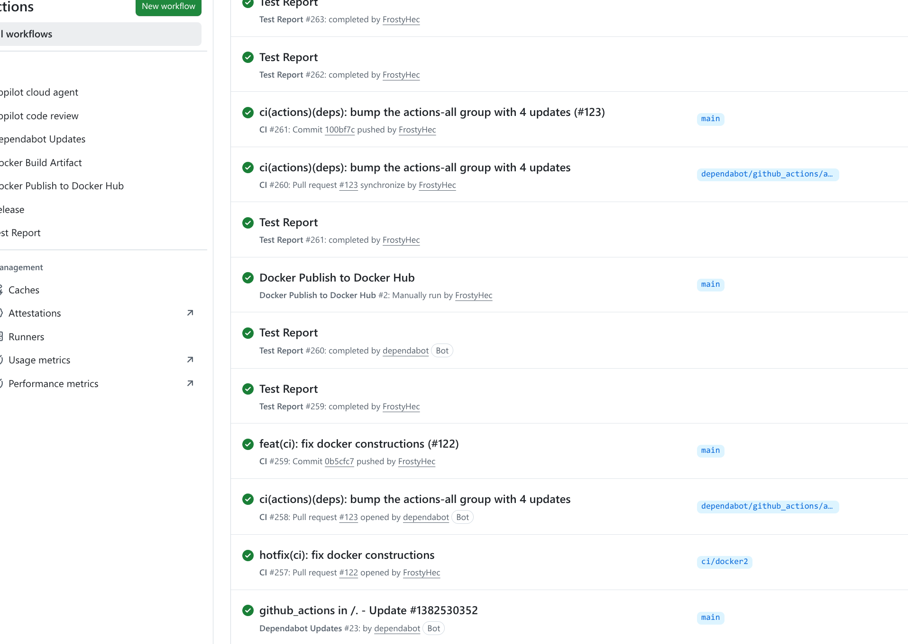

# CI/CD Pipeline Report

## Success Screenshot



More are available at our repo's [GitHub Actions Page](https://github.com/sustech-cs304/team-project-26spring-26s-5/actions).

## Overview

This project implements a comprehensive CI/CD pipeline using **GitHub Actions** as the primary automation platform, supplemented by local tooling via `Taskfile.yml` and `scripts/check.sh`. The pipeline covers code quality enforcement, automated testing, Docker image management, and multi-platform release publishing.

---

## Pipeline Steps and Tools

### Step 1 — Code Linting & Formatting

**Trigger:** Every pull request and every push to `main`
**Configuration:** `.github/workflows/ci.yml` → job `lint`

The pipeline first enforces code style and formatting across all packages before any tests are run.

| Sub-step | Package | Tool |
|---|---|---|
| Python dependency installation | `core`, `cli` | `uv` (Astral) |
| Python format check | `core`, `cli` | `ruff format --check` |
| Python lint check | `core`, `cli` | `ruff check` |
| Frontend dependency installation | `gui` | `pnpm 10.32.1` |
| Frontend format check | `gui` | `prettier --check` |

**Key technologies:** `uv`, `ruff`, `pnpm`, `prettier`, `actions/setup-python@v6`, `actions/setup-node@v6`

---

### Step 2 — Language Policy Check

**Trigger:** Every pull request and every push to `main`
**Configuration:** `.github/workflows/ci.yml` → job `language-check`

A custom Semgrep rule (`semgrep-rules.yaml`, rule ID: `no-cjk-characters`) scans all source files, GitHub workflow configurations, and shell scripts to ensure no CJK (Chinese/Japanese/Korean) characters appear in code. Documentation files are exempt; individual lines may be whitelisted with `# nosemgrep`.

```bash
semgrep --config semgrep-rules.yaml --no-git-ignore --error --quiet \
        packages/ .github/ scripts/
```

**Key technologies:** `semgrep`

---

### Step 3 — Python Testing & Coverage

**Trigger:** After Steps 1 and 2 pass (`needs: [lint, language-check]`)
**Configuration:** `.github/workflows/ci.yml` → job `test-python`

Both the `core` and `cli` packages are tested independently. The `core` package additionally generates a coverage report.

| Package | Test Command |
|---|---|
| `packages/core` | `uv run pytest tests/ -v --cov=agent_core --cov-report=term-missing --junitxml=pytest-report.xml` |
| `packages/cli` | `uv run pytest tests/ -v --junitxml=pytest-report.xml` |

After both runs, an inline Python script merges the two JUnit XML reports into a single `test-results/pytest-report.xml`, which is uploaded as a GitHub Actions artifact (`pytest-results-3.12`) for downstream consumption. The merge and upload steps use `if: always()` to preserve reports even when tests fail.

**Key technologies:** `pytest`, `pytest-cov` (JaCoCo equivalent for Python), `uv`, `actions/upload-artifact@v7`

---

### Step 4 — Frontend Testing, Type Checking & Build

**Trigger:** After Steps 1 and 2 pass (`needs: [lint, language-check]`)
**Configuration:** `.github/workflows/ci.yml` → job `test-vue`

| Sub-step | Tool |
|---|---|
| Unit testing | `vitest run` |
| TypeScript type checking | `vue-tsc --build` |
| Production build | `vite build` |

The `pnpm build` command in `packages/gui/package.json` runs `vue-tsc` and `vite build` in parallel via `run-p`.

> **Note:** End-to-end tests using **Playwright** (`pnpm test:e2e`) are configured in `package.json` but are not currently executed in the CI pipeline.

**Key technologies:** `vitest`, `vue-tsc`, `vite`, `pnpm`, `Node.js 20`

---

### Step 5 — Test Report Publication

**Trigger:** Upon completion of the CI workflow (success or failure)
**Configuration:** `.github/workflows/report.yml`

This workflow runs in the base repository's security context (via `workflow_run`) and performs two actions:

1. **GitHub Check Run** — Uses `dorny/test-reporter@v3` with the `java-junit` reporter format to publish a structured test result check on the commit.
2. **PR Comment** — Parses the merged JUnit XML and posts (or updates) a sticky comment on the pull request summarising: total tests, passed, failed, errors, skipped, duration, and failure details.

The comment is keyed by the header `ci-test-summary` via `marocchino/sticky-pull-request-comment@v3`, so repeated pushes to the same PR update the existing comment rather than creating new ones.

**Key technologies:** `dorny/test-reporter@v3`, `marocchino/sticky-pull-request-comment@v3`, `actions/download-artifact@v8`

---

### Step 6 — Docker Image Build (On-Demand)

**Trigger:** Manual (`workflow_dispatch`)
**Configuration:** `.github/workflows/docker-build.yml`

The `Dockerfile` uses a **multi-stage build**:

- **Stage 1 (`gui-builder`):** Node 20 + pnpm → builds the Vue frontend (`packages/gui/dist`)
- **Stage 2 (`app`):** `uv:python3.12-bookworm-slim` → installs Python runtime, copies `core`/`cli` sources, runs `uv sync --frozen --no-dev`, copies the GUI dist, and configures the entrypoint

The built image is saved as a gzip-compressed tar archive and uploaded as a GitHub Actions artifact (retained for 14 days). BuildKit layer caching is handled via `cache-from/cache-to: type=gha`.

**Key technologies:** `docker/setup-buildx-action@v3`, `docker/build-push-action@v6`, `uv`, `pnpm`

---

### Step 7 — Docker Hub Publishing (On-Demand)

**Trigger:** Manual (`workflow_dispatch`)
**Configuration:** `.github/workflows/docker-publish.yml`

Supports two modes:

- **Rebuild mode** (no `artifact_run_id` provided): re-builds from source and pushes directly.
- **Reuse mode** (`artifact_run_id` provided): downloads the previously built tar artifact, loads it with `docker load`, re-tags, and pushes.

Optionally pushes an additional `latest` tag. Credentials are stored as repository secrets (`DOCKERHUB_USERNAME`, `DOCKERHUB_TOKEN`).

**Key technologies:** `docker/login-action@v3`, `docker/build-push-action@v6`, `actions/download-artifact@v8`

---

### Step 8 — Multi-Platform Release (On Git Tag)

**Trigger:** Push of a `v*` tag (e.g., `v1.2.3`, `v1.2.3-beta.1`)
**Configuration:** `.github/workflows/release.yml`

Builds release artifacts in parallel across three platforms:

| Platform | Runner |
|---|---|
| Linux | `ubuntu-22.04` |
| Windows | `windows-latest` |
| macOS | `macos-latest` |

Each platform build follows this sequence:

1. Run `scripts/check.sh --check-only` (full repo check)
2. Build the Vue frontend (`pnpm build`)
3. Package the backend staging directory (`package_backend.py`)
4. Optionally pre-build the policy index (requires `EMBEDDING_API_KEY` secret)
5. Run a smoke test on the packaged backend
6. Build the desktop package (`package_desktop.sh`)
7. Upload platform artifacts

After all three platform builds complete, the `publish` job downloads all artifacts, organises them via `prepare_release_files.sh`, and creates a GitHub Release using `softprops/action-gh-release@v2`.

**Key technologies:** `softprops/action-gh-release@v2`, `uv`, `pnpm`, `vite`, `pytest` (smoke test)

---

### Step 9 — Automated Dependency Updates

**Configuration:** `.github/dependabot.yml`

Dependabot runs weekly and automatically opens pull requests for outdated dependencies:

| Ecosystem | Schedule | PR Limit | Grouping Strategy |
|---|---|---|---|
| Python (`pip`) | Every Monday 03:00 | 10 | minor/patch → one PR; major → one PR |
| GitHub Actions | Every Monday 04:00 | 5 | All updates → one PR |

All dependency PRs are assigned to `FrostyHec` for review.

---

## Pipeline Concurrency & Security Design

- **Concurrency control:** The CI workflow uses `concurrency.group: ci-${{ github.ref }}` with `cancel-in-progress: true`, so a new push to the same branch automatically cancels any still-running CI run.
- **Least-privilege permissions:** Regular CI only requests `contents: read`. The report workflow requests `checks: write`, `pull-requests: write`, `actions: read`, and `contents: read`. The release workflow requests `contents: write`.
- **Fork safety:** The `report.yml` workflow uses `workflow_run` and always checks out `ref: main` of the base repository. Untrusted inputs (branch name, SHA, run URL) are passed through environment variables rather than being interpolated directly into shell scripts.

---

## Local CI Equivalents

Developers can reproduce the CI pipeline locally using the following commands:

| Command | Coverage |
|---|---|
| `task ci` | Lint + all tests (Python & Vue) |
| `bash scripts/check.sh` | Lint + Semgrep + tests + type-check + build (with auto-fix) |
| `bash scripts/check.sh --check-only` | Same as above, read-only (mirrors Release CI) |
| `pre-commit run --all-files` | Ruff fix/format, Commitizen, trailing whitespace, YAML check |

> `scripts/check.sh --check-only` is the closest local equivalent to what the Release workflow executes on GitHub.

---

## Pipeline Summary Diagram

```
Push / PR
    │
    ├─► lint ───────────────────────────────────────────────┐
    │                                                       │
    └─► language-check ─────────────────────────────────────┤
                                                            │
                                              (both pass)   │
                                                            ▼
                                          ┌─────────────────────────────┐
                                          │  test-python                │
                                          │  (pytest + coverage + JUnit)│
                                          └──────────────┬──────────────┘
                                                         │
                                          ┌──────────────▼──────────────┐
                                          │  test-vue                   │
                                          │  (vitest + vue-tsc + vite)  │
                                          └──────────────┬──────────────┘
                                                         │
                                          ┌──────────────▼──────────────┐
                                          │  report (workflow_run)      │
                                          │  Check Run + PR Comment     │
                                          └─────────────────────────────┘

v* tag push
    └─► build (linux / windows / macos) ──► publish ──► GitHub Release

Manual trigger
    ├─► docker-build  ──► artifact (.tar.gz)
    └─► docker-publish ──► Docker Hub
```